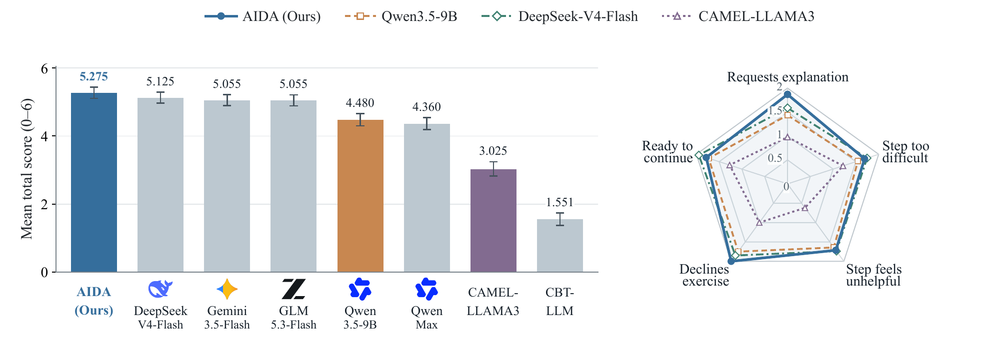
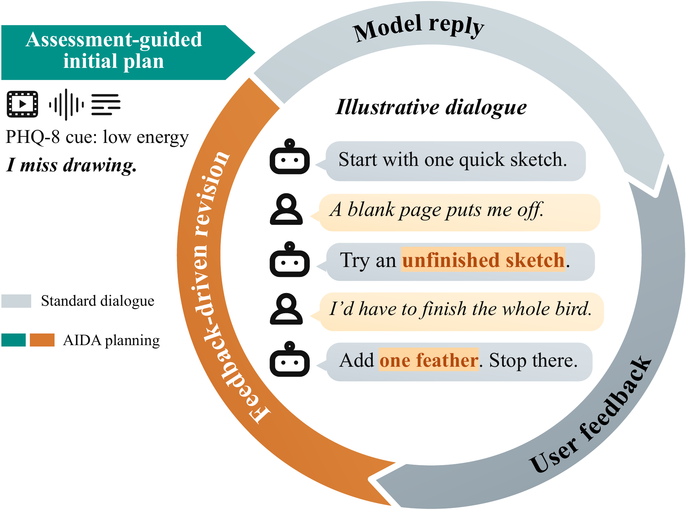
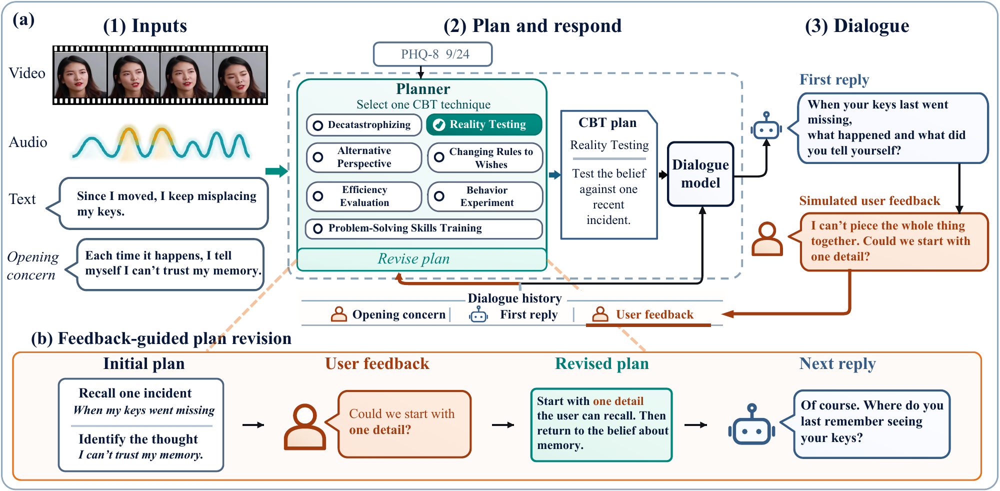
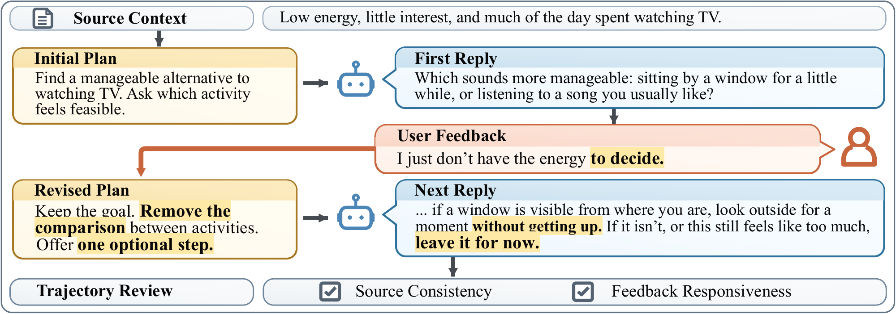
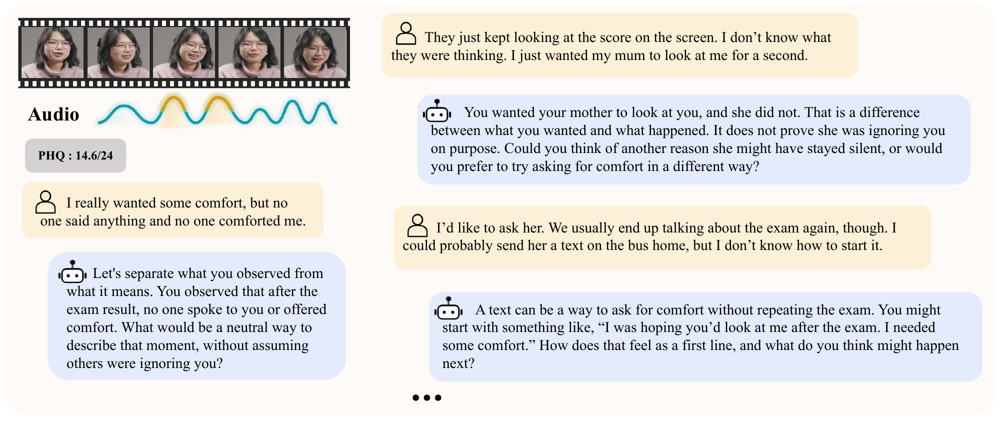
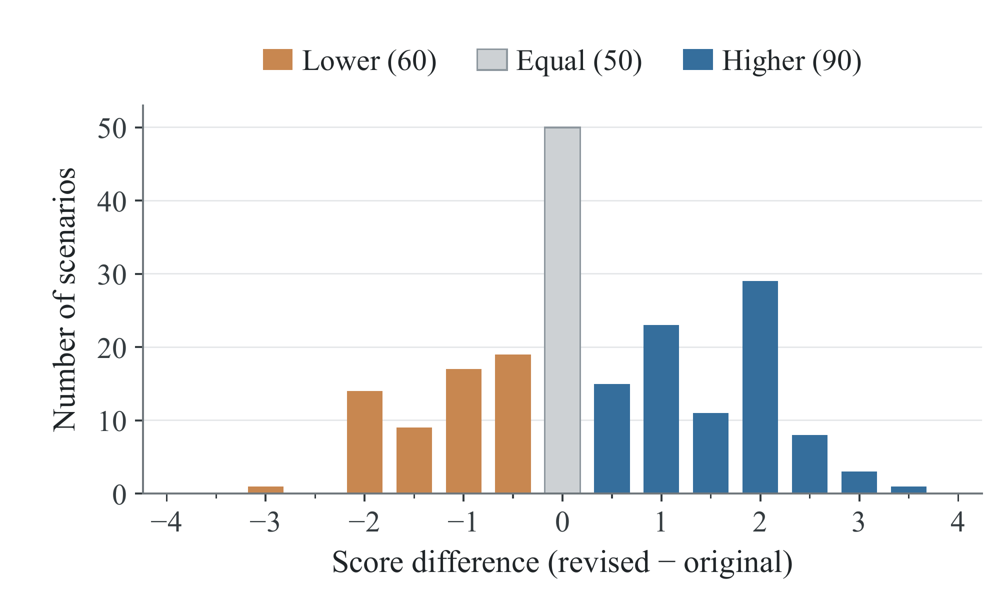

# AIDA

*AIDA: Unifying Multimodal Depression Assessment and Intervention through Closed-Loop Planning*

**Assessment-Informed Dialogue Adaptation (AIDA)** unifies multimodal depression assessment and intervention through an explicit, revisable plan. Assessment guides the first action, and user feedback guides subsequent revisions within the selected cognitive behavioral therapy (CBT) technique.

Yibo Wang, Jisheng Dang, Bimei Wang, Jingwen Zhao, Wenjun Ma, Wei-Shi Zheng, Qi Tian, and Bin Hu.

<details>
<summary>Paper abstract</summary>

Multimodal interviews can be used to estimate depressive symptom severity, yet translating such an assessment into psychological intervention requires selecting an initial step that aligns with the individual's goals and revising it in response to reported difficulties. To address this challenge, we propose Assessment-Informed Dialogue Adaptation (AIDA), a closed-loop framework that links multimodal depression assessment to intervention through an explicit and revisable plan. AIDA estimates depressive symptom severity from facial, acoustic, and linguistic cues. A planner then uses this estimate, when available, together with the user's concern, goal, and readiness to act to select a cognitive behavioral therapy (CBT) technique and a concrete action, which a dialogue model proposes. When the user reports an obstacle, the planner revises the focus or adjusts the difficulty of the exercise within the same technique, and the revised plan guides the next reply. We also introduce DepGuide, a bilingual dataset and interactive benchmark of 1,292 decision trajectories that record plans and replies before and after user feedback, providing supervision for planning, execution, and revision. Paired comparisons on DepGuide test how access to a severity score influences the plan and how revising that plan changes the next action. On DAIC-WOZ, AIDA predicts eight-item Patient Health Questionnaire (PHQ-8) scores with a mean absolute error (MAE) of 3.37, the lowest among the compared methods. On 200 DepGuide test scenarios, it reaches an automated intervention quality score of 5.275, the highest among eight systems, including strong recent large language models, and above the 4.480 of its Qwen3.5-9B backbone. With dialogue history and user feedback held fixed, following the revised plan rather than the original one improves the combined score for feedback fit and action feasibility by 0.333. Code is available at [the AIDA repository](https://github.com/YiboWang2002/AIDA).

</details>

[Main results](#paper-results) · [Framework](#how-aida-works) · [DepGuide](#the-depguide-benchmark) · [Example dialogue](#an-example-dialogue) · [Paired analyses](#what-changes-after-feedback) · [Run a dialogue](#run-a-dialogue) · [Train](#train)

## Paper results

### Intervention quality on DepGuide

**AIDA scores 5.275/6 across 200 test scenarios, the highest total among the eight systems compared in the paper.** Its Qwen3.5-9B backbone scores 4.480/6 under direct generation. The paired gain is **0.795**, with a 95% CI from 0.566 to 1.030. Action feasibility rises from 1.375 to 1.680 out of 2.

**Table III. Two-reply intervention quality.** Systems receive identical openings, available synthetic PHQ-8 totals, and feedback intents. GPT-6 Luna generates feedback and scores exchanges in separate calls. Scores range from 0 to 2 per dimension and from 0 to 6 overall. Gap to AIDA is AIDA's mean total minus each baseline's. Bold scores indicate the best results in this comparison.

| Method | Goal fit ↑ | Action feasibility ↑ | Feedback adaptation ↑ | Total ↑ | Gap to AIDA |
| --- | :---: | :---: | :---: | :---: | :---: |
| [CBT-LLM](https://aclanthology.org/2024.lrec-main.261/) | 0.737 | 0.490 | 0.323 | 1.551 | +3.724 |
| [CAMEL-LLAMA3](https://aclanthology.org/2024.findings-emnlp.832/) | 1.080 | 0.920 | 1.025 | 3.025 | +2.250 |
| [Qwen-Max](https://help.aliyun.com/en/model-studio/qwen-max) | 1.565 | 1.305 | 1.490 | 4.360 | +0.915 |
| [Qwen3.5-9B](https://huggingface.co/Qwen/Qwen3.5-9B) | 1.510 | 1.375 | 1.595 | 4.480 | +0.795 |
| [Gemini-3.5-Flash](https://deepmind.google/models/model-cards/gemini-3-5-flash/) | 1.680 | 1.575 | **1.800** | 5.055 | +0.220 |
| [GLM-5.3-Flash](https://huggingface.co/zai-org/GLM-5.3-Flash) | 1.730 | 1.585 | 1.740 | 5.055 | +0.220 |
| [DeepSeek-V4-Flash](https://arxiv.org/abs/2606.19348) | 1.750 | 1.620 | 1.755 | 5.125 | +0.150 |
| **AIDA (Ours)** | **1.810** | **1.680** | 1.785 | **5.275** | — |

<p align="center">
  <a href="assets/figure-4-results.png"></a>
</p>

*Figure 4. Intervention quality on 200 DepGuide test scenarios, scored by GPT-6 Luna. Left, mean totals out of 6 combine goal fit, action feasibility, and feedback adaptation, each out of 2. Right, mean feedback adaptation out of 2 across five prespecified feedback intents for AIDA, Qwen3.5-9B, DeepSeek-V4-Flash, and CAMEL-LLAMA3. Higher scores indicate better performance.*

### PHQ-8 prediction on DAIC-WOZ

**Table II. PHQ-8 severity estimation on 47 official DAIC-WOZ test interviews. Baseline results come from cited studies. Both AIDA variants use the same interviews. MAE and RMSE are measured on the PHQ-8 scale.**

| Method | Input | MAE ↓ | RMSE ↓ |
| --- | --- | :---: | :---: |
| [SVM](https://doi.org/10.1016/j.jad.2021.09.001) | Text, audio, visual | 3.98 | 5.11 |
| [Topic](https://doi.org/10.1145/3133944.3133945) | Text, audio, visual | 3.96 | 4.99 |
| [RF](https://doi.org/10.1145/3133944.3133951) | Text | 3.87 | 4.98 |
| [Dual encoder](https://doi.org/10.3389/fpsyt.2023.1160291) | Text | 3.80 | 4.67 |
| [Symptom Prediction](https://doi.org/10.1186/s40708-023-00185-9) | Text | 3.78 | — |
| [MeBERT+ALL](https://aclanthology.org/2024.clinicalnlp-1.28/) | Text and lexicons | 3.59 | — |
| [Agarwal et al.](https://aclanthology.org/2024.lrec-main.87/) | Text | 3.52 | — |
| [LMIQ](https://aclanthology.org/2024.findings-emnlp.23/) | Text | 3.46 | 4.30 |
| AIDA text (Ours) | Text | 3.38 | 4.22 |
| **AIDA (Ours)** | Text, audio, visual | **3.37** | **4.21** |

## How AIDA works

**Returning to drawing.** The user misses drawing, and the assessment points to low energy. AIDA suggests a quick sketch. When the user says a blank page puts them off, AIDA suggests picking up an unfinished drawing. The user then worries about having to finish the whole bird, so AIDA suggests adding one feather and stopping there.

<p align="center">
  <a href="assets/figure-1-motivation.png"></a>
</p>

*Figure 1. AIDA extends standard dialogue, shown in gray, by introducing assessment-guided initial planning in teal and feedback-driven plan revision in orange. Assessment guides a manageable first step, while successive feedback refines where to start and where to stop.*

**The assessment informs the planner. The user's feedback informs the revision.** The planner can take a PHQ-8 total alongside the opening concern, select one of seven CBT techniques, and write an initial plan. The executor uses the technique, plan, and dialogue history to generate the first reply. After the user responds, the planner receives its previous plan and the updated history. In Figure 2, the request for one detail changes the next question while the technique remains Reality Testing.

<p align="center">
  <a href="assets/figure-2-framework.png"></a>
</p>

*Figure 2. Overview of AIDA. In panel a, the PHQ-8 score from multimodal assessment enters the planner alongside the user's concern to guide CBT technique selection and initial planning. The dialogue model generates a reply from the plan, and user feedback returns to the planner for revision. Panel b illustrates revision within Reality Testing, narrowing incident recall to one concrete detail.*

## The DepGuide benchmark

DepGuide is a bilingual benchmark built around a decision trajectory. Each scenario records the opening concern, the selected technique, the initial plan and reply, feedback on that reply, and the revised plan and reply. A trajectory supplies three planning targets and two response targets.

<p align="center">
  <a href="assets/figure-3-depguide.png"></a>
</p>

*Figure 3. Construction of a DepGuide decision trajectory illustrated by a development example. The source context grounds the initial plan and first reply. When the user indicates that choosing between two activities is itself demanding, the revised plan preserves the intervention goal and replaces the choice with one optional action. The next reply makes this action concrete by suggesting looking outside without getting up, while allowing the user to pause. Trajectory review checks consistency with the source and responsiveness to the stated feedback.*

**Table I. Composition of 1,292 DepGuide decision trajectories. Records sharing an origin form source groups that remain disjoint across splits. Synthetic PHQ-8 totals sum existing source item scores or newly constructed scores consistent with the scenario. Unavailable denotes missing synthetic totals.**

| DepGuide | Train | Dev. | Test | All |
| --- | :---: | :---: | :---: | :---: |
| Scenarios | 994 | 98 | 200 | 1,292 |
| Source groups | 934 | 90 | 180 | 1,204 |
| Chinese scenarios | 694 | 68 | 140 | 902 |
| English scenarios | 300 | 30 | 60 | 390 |
| **Synthetic PHQ-8 total** |  |  |  |  |
| From source items | 197 | 19 | 40 | 256 |
| From new synthetic items | 399 | 40 | 80 | 519 |
| Unavailable | 398 | 39 | 80 | 517 |

### Independent review of dataset quality

Two annotators with counseling backgrounds independently reviewed **100 test scenarios**, stratified by source family, without access to automated review results. They assessed source fidelity, consistency of the available PHQ-8 total, and the reference trajectory and evaluation criteria. **In 93 of the 100 scenarios, neither annotator flagged a major issue on any applicable criterion.**

| Criterion | Applicable scenarios | Agreement on major-issue presence | Gwet's AC1 |
| --- | :---: | :---: | :---: |
| Source fidelity | 100 | 97% | 0.97 |
| PHQ-8 consistency | 60 | 96.7% | 0.97 |
| Reference trajectory and evaluation criteria | 100 | 99% | 0.99 |

After excluding the seven scenarios flagged by either annotator, both main paired gains remain positive on the remaining 193 scenarios, with 95% CIs above zero. These are AIDA over its backbone on complete exchanges and revised over original plans under fixed feedback. This review assesses the dataset; the expert assessment of generated dialogues is reported separately in Table IV.

## An example dialogue

After an exam, the speaker wanted comfort from her mother. When the conversation turns to sending her a text, the user says she could do that but does not know how to begin. AIDA uses the speaker's own phrasing to suggest an opening line.

<p align="center">
  <a href="assets/figure-5-dialogue.png"></a>
</p>

*Figure 5. An AIDA dialogue about seeking comfort after an exam. Video, audio, and the opening concern are shown with a PHQ-8 estimate of 14.6 out of 24. Across two feedback turns, AIDA helps the user distinguish observations from interpretations and identify a concrete way to ask her mother for comfort.*

## What changes after feedback?

### Holding the dialogue history fixed

**Following the revised plan raises the combined reply score from 3.103 to 3.435**, even when the dialogue model already sees the same history and user feedback.

**Table V. Effect of plan revision in 200 paired DepGuide scenarios. History, feedback, technique, dialogue model, and decoding are fixed. GPT-6 Luna scores replies 0 to 2 per dimension and 0 to 4 overall. Gains are Revised minus Original, averaged over both orders, with 95% source-group bootstrap CIs.**

| Metric | Original plan | Revised plan | Paired gain | 95% CI |
| --- | :---: | :---: | :---: | :---: |
| Feedback fit ↑ | 1.5475 | **1.7300** | +0.1825 | [0.078, 0.287] |
| Action feasibility ↑ | 1.5550 | **1.7050** | +0.1500 | [0.059, 0.241] |
| Total ↑ | 3.1025 | **3.4350** | +0.3325 | [0.147, 0.522] |

<p align="center">
  <a href="assets/figure-6-revision.png"></a>
</p>

*Figure 6. Paired effects of plan revision on 200 DepGuide test scenarios. The horizontal axis shows revised-plan minus original-plan reply scores, and the vertical axis counts scenarios. Scores combine feedback fit and action feasibility for a total out of 4 and are averaged over both presentation orders. History, feedback, CBT technique, and dialogue model are held fixed.*

### Expert review of the full exchange

**Table IV. Mean ratings from one blinded expert on the first 60 pairs in randomized DepGuide test order, comparing AIDA with direct Qwen3.5-9B generation. Complete two-reply exchanges are scored from 0 to 2 per dimension and 0 to 6 overall.** AIDA received the higher total in 46 pairs, equal totals in nine, and the lower total in five. The largest difference was in feedback adaptation.

| Method | Goal fit ↑ | Action feasibility ↑ | Feedback adaptation ↑ | Total ↑ |
| --- | :---: | :---: | :---: | :---: |
| Qwen3.5-9B | 1.350 | 1.350 | 1.067 | 3.767 |
| **AIDA (Ours)** | **1.900** | **1.900** | **1.800** | **5.600** |

### Contributions of the planner and executor

Giving the backbone a trained planner raises the mean total from **4.480 to 4.870**. Training the executor raises it further to **5.275**.

**Table VI. Planning and execution contributions on 200 DepGuide scenarios. GPT-6 Luna rates two-reply exchanges on goal fit, action feasibility, and feedback adaptation, each scored from 0 to 2 for a total out of 6. All covers the full set. With and Without denote the 120 scenarios with synthetic PHQ-8 totals and the 80 without. Gains compare adjacent configurations across all scenarios, with 95% source-group bootstrap CIs.**

| Configuration | All ↑ | With PHQ-8 ↑ | Without PHQ-8 ↑ | Paired gain | 95% CI |
| --- | :---: | :---: | :---: | :---: | :---: |
| Qwen3.5-9B | 4.480 | 4.308 | 4.738 | Reference |  |
| Planner + backbone | 4.870 | 5.008 | 4.663 | +0.390 | [0.153, 0.597] |
| **AIDA (Ours)** | **5.275** | **5.292** | **5.250** | +0.405 | [0.193, 0.629] |

### Replies with assessment information

**Table VII. Assessment-informed replies to feedback in 120 paired DepGuide scenarios. Systems receive identical synthetic PHQ-8 totals and item scores, with matched feedback intents. GPT-6 Luna sees all items and scores each metric from 0 to 2. Gains are AIDA minus Qwen3.5-9B, averaged over both orders. Bold gains have 95% source-group bootstrap CIs above zero.**

| Metric ↑ | Qwen3.5-9B | AIDA (Ours) | Paired gain | 95% CI |
| --- | :---: | :---: | :---: | :---: |
| Feedback adaptation | 1.550 | 1.646 | +0.096 | [−0.033, 0.227] |
| Action feasibility | 1.475 | 1.746 | **+0.271** | **[0.157, 0.387]** |
| Response focus | 1.246 | 1.854 | **+0.608** | **[0.521, 0.697]** |

### Controlled effects of assessment and planning

**Item-level assessment.** With the same planner and dialogue model, adding the eight item scores to the PHQ-8 total raises response focus after feedback from **1.692 to 1.821**. The added assessment fields enter the planner, and their effect on the reply passes through its plan. Feedback follows the same intent in both conditions, and the evaluator sees the full total and item scores for both candidates.

**Supplementary Table S4, replies after feedback.** The comparison covers 120 paired scenarios from 112 source groups. Each metric ranges from 0 to 2. Gains are total plus items minus total only, with 95% source-group bootstrap CIs. Feedback adaptation is the primary outcome. This is a separate paired evaluation from the model comparison in Table VII.

| Metric ↑ | Total only | Total plus items | Paired gain | 95% CI |
| --- | :---: | :---: | :---: | :---: |
| Feedback adaptation | 1.571 | 1.671 | +0.100 | [−0.008, 0.209] |
| Action feasibility | 1.650 | 1.717 | +0.067 | [−0.017, 0.160] |
| Response focus | 1.692 | 1.821 | **+0.129** | **[0.052, 0.209]** |

**Planner access to feedback.** Both conditions replan once, and the executor receives feedback in both. Across 200 test scenarios, letting the planner also see the feedback raises action feasibility from 1.565 to 1.675, with a paired gain of 0.110 and a 95% CI from 0.013 to 0.205. The combined score rises from 3.148 to 3.360.

**Matched replanning budgets.** The backbone planner and the trained planner each revise the same initial plan once. The same trained executor generates the replies with matched decoding and token limits. Across 199 scored pairs, the trained planner raises action feasibility from 1.568 to 1.681, with a paired gain of 0.113 and a 95% CI from 0.018 to 0.205.

### Sensitivity to source composition

**Table VIII. Paired gains after excluding source families.** Each row excludes every test case in a source group represented by the named family. On the same retained cases, exchange gain compares AIDA with direct backbone generation (out of 6), and revision gain compares revised and original plans under fixed feedback (out of 4). The MIRROR/ESConv family includes FailedESConv.

| Excluded family | Retained cases | Retained groups | Exchange gain | Revision gain |
| --- | :---: | :---: | :---: | :---: |
| CPsDD | 130 | 114 | +0.708 | +0.335 |
| CACTUS | 150 | 134 | +0.827 | +0.380 |
| DESC | 150 | 141 | +0.760 | +0.263 |
| MIRROR/ESConv | 160 | 150 | +0.856 | +0.316 |
| Psy-Insight/PsyDTCorpus | 190 | 171 | +0.811 | +0.342 |

## Run a dialogue

Use Python 3.10 or later and a CUDA device with BF16 support for the dialogue model. Install from the repository root, then place a trained planner adapter and a dialogue adapter in `checkpoints/planner/` and `checkpoints/dialogue/`. Each contains `adapter_config.json` and `adapter_model.safetensors`. This code release uses separately supplied checkpoints and data. The shared backbone is [Qwen3.5-9B](https://huggingface.co/Qwen/Qwen3.5-9B).

```bash
git clone https://github.com/YiboWang2002/AIDA.git
cd AIDA
python -m pip install -r requirements.txt
mkdir -p work
cat > work/case.json <<'JSON'
{
  "language": "en",
  "intake_text": "The speaker has recently moved and keeps misplacing everyday items.",
  "problem_text": "The speaker worries that these incidents mean their memory is unreliable.",
  "history": [
    {"role": "user", "content": "I lost my keys again. Now I keep telling myself I can't trust my memory."}
  ]
}
JSON

python -m depreplan.dialogue --case work/case.json \
  --base-model Qwen/Qwen3.5-9B \
  --planner-adapter checkpoints/planner --executor-adapter checkpoints/dialogue \
  --interactive
```

The first JSON record contains `technique`, `plan`, and `reply`. At the prompt, try *Could we start with just one detail?* The second record shows the revised plan and next reply. For a scripted run, replace `--interactive` with `--feedback "Could we start with just one detail?"`. The opening can include prior English or Chinese dialogue. Set `language` to `en` or `zh`.

## Estimate a PHQ-8 total

The optional assessment module predicts one continuous total per interview. It aligns participant turns with acoustic and facial descriptors, encodes the transcript with frozen MPNet, and pools the resulting sequence with a bidirectional GRU and attention. A separately trained text regressor handles interviews with no observed acoustic or visual features. The text encoder is [all-mpnet-base-v2](https://huggingface.co/sentence-transformers/all-mpnet-base-v2).

The following commands take a DAIC-WOZ participant archive and the two trained regression checkpoints.

```bash
python -m assessment.prepare --interview work/interview.zip --output work/turns.npz
python -m assessment.predict --features work/turns.npz \
  --text-checkpoint checkpoints/text.pt --checkpoint checkpoints/multimodal.pt \
  > work/assessment.json
```

For a dialogue about the **same interview**, add `--assessment-file work/assessment.json` to the dialogue command. The estimator reports the raw prediction used for MAE and RMSE, plus a value bounded to the 0–24 scale for the planner. The dialogue model receives the technique, plan, and conversation history.

## Train

**Planner and dialogue adapters.** Supply one training JSONL per role. Each row holds a task, language, context, history, and target. Planner supervision covers technique selection, initial planning, and revision after feedback. Dialogue supervision uses the reply under the corresponding plan. The [record contracts](depreplan/contracts.py) and [prompt encoder](depreplan/prompts.py) define the formats and target-token mask.

```bash
python -m training.train --role planner --train-file work/planner.jsonl \
  --initial-adapter checkpoints/initial-planner --output-dir checkpoints/planner
python -m training.train --role dialogue --train-file work/dialogue.jsonl \
  --output-dir checkpoints/dialogue
```

The paper continues training an existing planner adapter and initializes the dialogue adapter on the frozen backbone. Omit `--initial-adapter` to train a new planner adapter. For example, a planner training row can have this form:

```json
{"task":"c_session_plan","language":"en","history":[],"context":{"intake_text":"I keep misplacing my keys.","technique":"Reality Testing"},"target":{"plan_text":"Ask for one concrete example."}}
```

**Severity estimator.** Prepare one `.npz` per interview. The training and development CSVs each have two columns, `features` and `phq8`, with feature paths relative to the CSV. Train the text regressor first, then initialize the multimodal model from its checkpoint. Both stages select the checkpoint by development MAE.

```bash
mkdir -p checkpoints
python -m assessment.train --stage text --train work/train.csv --dev work/dev.csv \
  --output checkpoints/text.pt
python -m assessment.train --stage multimodal --train work/train.csv --dev work/dev.csv \
  --text-checkpoint checkpoints/text.pt --output checkpoints/multimodal.pt
```

## Evaluate on DepGuide

| Paired task | Held fixed | Changed within the scenario |
| --- | --- | --- |
| Assessment availability | Opening, background, and decoding settings | On the 59 development scenarios with a synthetic total, the initial planner receives or omits that total. |
| Plan revision | First reply, user feedback, CBT technique, executor, and decoding settings | On the 200 test scenarios, the executor follows either the original plan or its revision. |
| Item-level assessment | Planner and executor checkpoints, scenario, feedback intent, and full assessment visible to the evaluator | On 120 test scenarios, the planner receives the total only or the total plus eight item scores. |
| Planner access to feedback | Initial plan, dialogue history, executor access to feedback, and one replanning call | The planner receives or omits the latest user feedback. |
| Matched replanning budget | History, feedback, initial plan, trained executor, decoding, and one replanning call | The trained planner replaces the backbone planner. |

To generate both next replies from a single dialogue, add `--compare-plans` to the dialogue command and provide feedback. The second JSON record contains `history`, `original_plan`, `original_reply`, `revised_plan`, and `revised_reply`. Pass the shared history and both replies to `evaluation.prompts.revision_prompts` to construct the two anonymous presentations.

The paper uses GPT-6 Luna in separate calls for user simulation and assessment. The [evaluation prompts](evaluation/prompts.py) construct the simulated user turn, the anonymized two-reply assessment, and both presentation orders of a fixed-feedback comparison. Supply the resulting case-level judgments as JSONL. The following commands run offline using the Python standard library. Each subcommand's `--help` gives a complete row format.

```bash
python evaluation/score.py dialogue work/dialogue-scores.jsonl --baseline backbone --method depreplan
python evaluation/score.py revision work/revision-scores.jsonl
```
