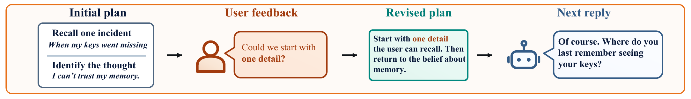

# DepRePlan

*From Multimodal Depression Assessment to Feedback-Guided Intervention in Brief Dialogues*

DepRePlan selects a cognitive behavioral therapy (CBT) technique, plans a first action, and turns that plan into a reply. When the user identifies an obstacle, the planner keeps the technique and revises the action. In the example below, the user finds it hard to reconstruct an entire incident. The revised plan asks for one detail they can recall.

<p align="center">
  
</p>

*Figure 2(b) from the paper. The feedback changes what the system asks the user to do next.*

[Run a dialogue](#run-a-dialogue) · [Estimate a PHQ-8 total](#estimate-a-phq-8-total) · [Train](#train) · [Evaluate on DepGuide](#evaluate-on-depguide) · [Paper results](#paper-results)

## Run a dialogue

Use Python 3.10 or later and a CUDA device with BF16 support for the dialogue model. Install from the repository root, then place a trained planner adapter and a dialogue adapter in `checkpoints/planner/` and `checkpoints/dialogue/`. Each contains `adapter_config.json` and `adapter_model.safetensors`. This code release uses separately supplied checkpoints and data. The shared backbone is [Qwen3.5-9B](https://huggingface.co/Qwen/Qwen3.5-9B).

```bash
python -m pip install -r requirements.txt
mkdir -p work
cat > work/case.json <<'JSON'
{
  "language": "en",
  "intake_text": "The speaker has recently moved and keeps misplacing everyday items.",
  "problem_text": "The speaker worries that these incidents mean their memory is unreliable.",
  "history": [
    {"role": "user", "content": "I lost my keys again. Now I keep telling myself I can't trust my memory."}
  ]
}
JSON

python -m depreplan.dialogue --case work/case.json \
  --base-model Qwen/Qwen3.5-9B \
  --planner-adapter checkpoints/planner --executor-adapter checkpoints/dialogue \
  --interactive
```

The first JSON record contains `technique`, `plan`, and `reply`. At the prompt, try *Could we start with just one detail?* The second record shows the revised plan and next reply. For a scripted run, replace `--interactive` with `--feedback "Could we start with just one detail?"`. The opening can include prior English or Chinese dialogue. Set `language` to `en` or `zh`.

## Estimate a PHQ-8 total

The optional assessment module predicts one continuous total per interview. It aligns participant turns with acoustic and facial descriptors, encodes the transcript with frozen MPNet, and pools the resulting sequence with a bidirectional GRU and attention. A separately trained text regressor handles interviews with no observed acoustic or visual features. The text encoder is [all-mpnet-base-v2](https://huggingface.co/sentence-transformers/all-mpnet-base-v2).

With a DAIC-WOZ participant archive and the two trained regression checkpoints, run:

```bash
python -m assessment.prepare --interview work/interview.zip --output work/turns.npz
python -m assessment.predict --features work/turns.npz \
  --text-checkpoint checkpoints/text.pt --checkpoint checkpoints/multimodal.pt \
  > work/assessment.json
```

For a dialogue about the **same interview**, add `--assessment-file work/assessment.json` to the dialogue command. The estimator reports the raw prediction used for MAE and RMSE, plus a value bounded to the 0–24 scale for the planner. The dialogue model receives the technique, plan, and conversation history.

## Train

**Planner and dialogue adapters.** Supply one training JSONL per role. Each row holds a task, language, context, history, and target. Planner supervision covers technique selection, initial planning, and revision after feedback. Dialogue supervision uses the reply under the corresponding plan. The [record contracts](depreplan/contracts.py) and [prompt encoder](depreplan/prompts.py) define the formats and target-token mask.

```bash
python -m training.train --role planner --train-file work/planner.jsonl \
  --initial-adapter checkpoints/initial-planner --output-dir checkpoints/planner
python -m training.train --role dialogue --train-file work/dialogue.jsonl \
  --output-dir checkpoints/dialogue
```

The paper continues training an existing planner adapter and initializes the dialogue adapter on the frozen backbone. Omit `--initial-adapter` to train a new planner adapter. For example, a planner training row can have this form:

```json
{"task":"c_session_plan","language":"en","history":[],"context":{"intake_text":"I keep misplacing my keys.","technique":"Reality Testing"},"target":{"plan_text":"Ask for one concrete example."}}
```

**Severity estimator.** Prepare one `.npz` per interview. The training and development CSVs each have two columns, `features` and `phq8`, with feature paths relative to the CSV. Train the text regressor first, then initialize the multimodal model from its checkpoint. Both stages select the checkpoint by development MAE.

```bash
mkdir -p checkpoints
python -m assessment.train --stage text --train work/train.csv --dev work/dev.csv \
  --output checkpoints/text.pt
python -m assessment.train --stage multimodal --train work/train.csv --dev work/dev.csv \
  --text-checkpoint checkpoints/text.pt --output checkpoints/multimodal.pt
```

## Evaluate on DepGuide

DepGuide contains 1,292 Chinese and English decision trajectories, with 994 training, 98 development, and 200 test scenarios. Two paired tasks distinguish what the planner learns from the assessment and what it learns from feedback.

| Paired task | Held fixed | Changed within the scenario |
| --- | --- | --- |
| Assessment availability | Opening, background, and decoding settings | The initial planner receives or omits the synthetic PHQ-8 total. |
| Plan revision | First reply, actual feedback, CBT technique, executor, and decoding settings | The executor follows the original or the revised plan. |

To generate both next replies from a single dialogue, add `--compare-plans` to the dialogue command and provide feedback. The second JSON record contains `history`, `original_plan`, `original_reply`, `revised_plan`, and `revised_reply`. Pass the shared history and both replies to `evaluation.prompts.revision_prompts` to construct the two anonymous presentations.

The paper uses GPT-6 Luna in separate calls for user simulation and assessment. The [evaluation prompts](evaluation/prompts.py) construct the simulated user turn, the anonymized two-reply assessment, and both presentation orders of a fixed-feedback comparison. Supply the resulting case-level judgments as JSONL. The following commands run offline using the Python standard library. Each subcommand's `--help` gives a complete row format.

```bash
python evaluation/score.py dialogue work/dialogue-scores.jsonl --baseline backbone --method depreplan
python evaluation/score.py revision work/revision-scores.jsonl
```

## Paper results

**Two-reply intervention quality.** On the same 200 DepGuide scenarios, adding a planner increases the total by 0.390 points. Training the executor contributes another 0.405. The total combines goal fit, action feasibility, and feedback adaptation, each scored from 0 to 2. Values are from Table VI.

| Configuration | Mean total ↑ (0–6) | Gain over preceding configuration | Paired 95% CI |
| --- | ---: | ---: | ---: |
| Qwen3.5-9B, direct generation | 4.480 | | |
| DepRePlan planner + backbone executor | 4.870 | +0.390 | [0.153, 0.597] |
| DepRePlan planner + trained executor | **5.275** | +0.405 | [0.193, 0.629] |

**What changes when the executor already knows the feedback?** Table V holds the dialogue history and executor fixed. Replacing the original plan increases both feedback fit and action feasibility. The estimates average the two presentation orders within each scenario. Confidence intervals use 2,000 bootstrap samples drawn at the source-group level.

| Next-reply score | Original plan | Revised plan | Paired gain | 95% CI |
| --- | ---: | ---: | ---: | ---: |
| Feedback fit ↑ (0–2) | 1.5475 | 1.7300 | +0.1825 | [0.078, 0.287] |
| Action feasibility ↑ (0–2) | 1.5550 | 1.7050 | +0.1500 | [0.059, 0.241] |
| Total ↑ (0–4) | 3.1025 | **3.4350** | **+0.3325** | **[0.147, 0.522]** |

<p align="center">
  
</p>

*Figure 6 from the paper. Each difference is the score under the revised plan minus the score under the original plan in the same scenario.*

**Interview assessment.** On the 47 official DAIC-WOZ test interviews, the multimodal estimator achieves **3.37 MAE** and **4.21 RMSE** in PHQ-8 points. The text model obtains 3.38 and 4.22 on the same participants (Table II).
