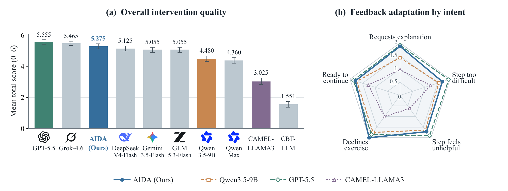
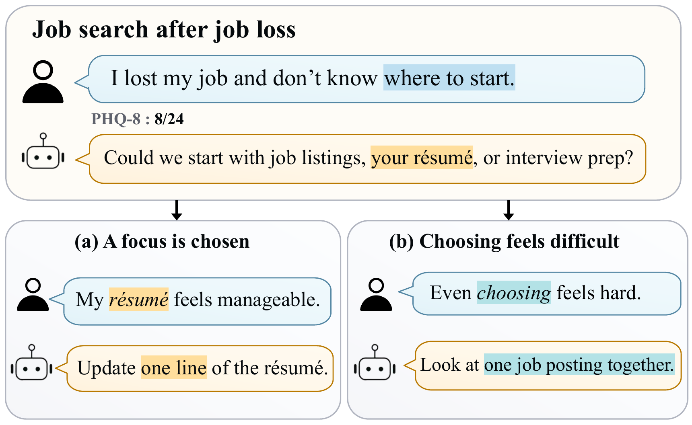
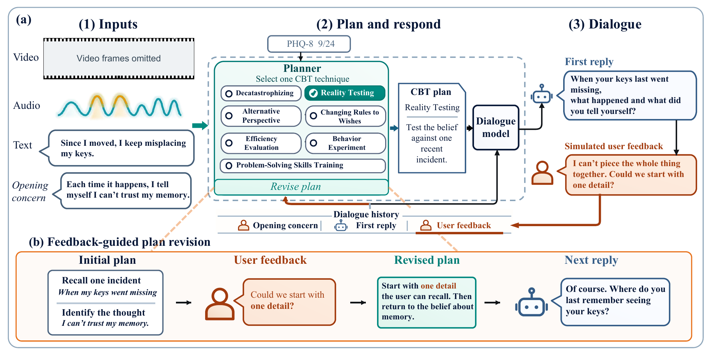
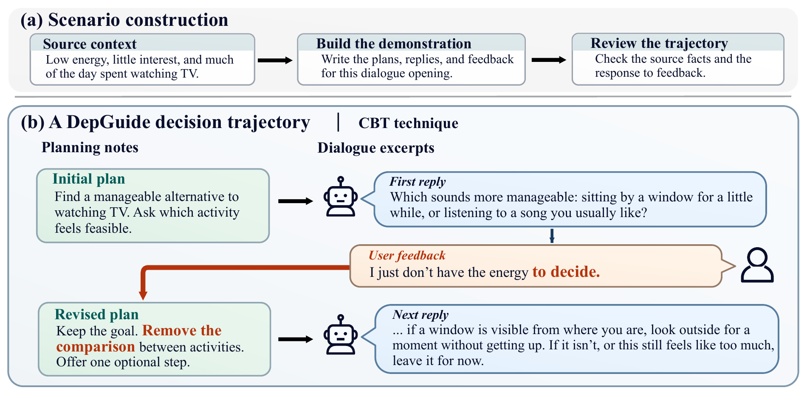
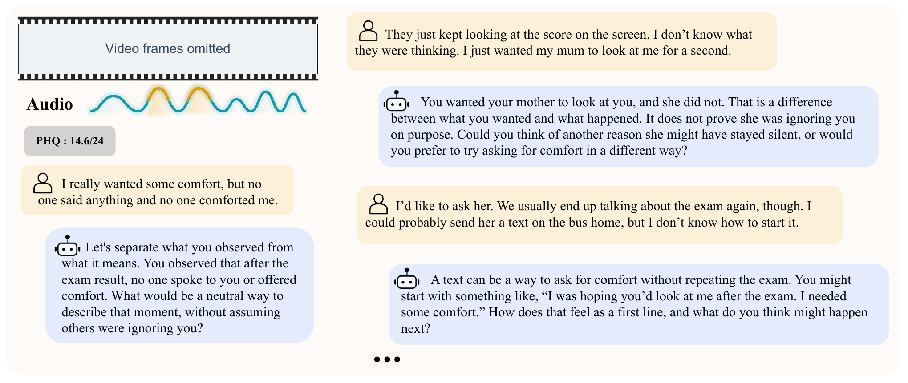

# AIDA

*From Multimodal Depression Assessment to Feedback-Guided Intervention*

**Assessment-Informed Dialogue Adaptation (AIDA)** connects multimodal depression assessment to a concrete intervention plan. When a user explains why a proposed step is difficult, the planner revises that step within the selected CBT technique.

<details>
<summary>Paper abstract</summary>

Multimodal interviews can reveal the severity of depressive symptoms. Using that assessment to guide psychological intervention requires choosing a first step that fits the person’s goals and adapting it when they explain what makes it difficult. We introduce Assessment-Informed Dialogue Adaptation (AIDA), a closed-loop framework that connects multimodal depression assessment to intervention through an explicit, revisable plan. AIDA estimates the severity of depressive symptoms from facial, acoustic, and linguistic cues. Its planner uses the user’s concern, goal, readiness to act, and available severity estimate to select a cognitive behavioral therapy (CBT) technique and specify an action. A dialogue model proposes that action. When the user reports an obstacle, the planner adjusts the focus or difficulty of the exercise within the same technique, guiding the model’s next reply. We also introduce DepGuide, a bilingual dataset and interactive benchmark comprising 1,292 decision trajectories. Each trajectory records the plans and replies before and after user feedback, providing supervision for planning, execution, and revision. Paired comparisons test how access to a severity score influences the initial plan and how revising that plan changes the next action. On the Wizard-of-Oz subset of the Distress Analysis Interview Corpus (DAIC-WOZ), AIDA predicts eight-item Patient Health Questionnaire (PHQ-8) scores with a mean absolute error (MAE) of 3.37 points. In automated evaluation on 200 DepGuide test scenarios, it scores 5.275 out of 6 for intervention quality across two replies, compared with 4.480 for its Qwen3.5-9B backbone. Even when the dialogue model receives the same history and user feedback, using the revised plan improves the combined score for feedback fit and action feasibility by 0.333 points out of 4. Code is available at [the AIDA repository](https://github.com/YiboWang2002/AIDA).

</details>

[Main results](#paper-results) · [Framework](#how-aida-works) · [DepGuide](#the-depguide-benchmark) · [Example dialogue](#an-example-dialogue) · [Paired analyses](#what-changes-after-feedback) · [Run a dialogue](#run-a-dialogue) · [Train](#train)

## Paper results

### Intervention quality on DepGuide

**AIDA scored 5.275/6 across 200 test scenarios, ranking third among ten systems.** Its Qwen3.5-9B backbone scored 4.480/6 under direct generation. The paired gain was **0.795 points** (95% CI [0.566, 1.030]). The largest difference was in action feasibility, which rose from 1.375 to 1.680 out of 2.

**Table III. Two-reply intervention quality.** Each system receives the same opening. GPT-6 Luna simulates the user's feedback in response to that system's first reply and scores the completed exchange in a separate call with system identities hidden. Each dimension ranges from 0 to 2 and the total from 0 to 6. Bold scores mark the column maxima.

| Method | Goal fit ↑ | Action feasibility ↑ | Feedback adaptation ↑ | Total ↑ |
| --- | :---: | :---: | :---: | :---: |
| [CBT-LLM](https://aclanthology.org/2024.lrec-main.261/) | 0.737 | 0.490 | 0.323 | 1.551 |
| [CAMEL-LLAMA3](https://aclanthology.org/2024.findings-emnlp.832/) | 1.080 | 0.920 | 1.025 | 3.025 |
| [Qwen-Max](https://help.aliyun.com/en/model-studio/qwen-max) | 1.565 | 1.305 | 1.490 | 4.360 |
| [Qwen3.5-9B](https://huggingface.co/Qwen/Qwen3.5-9B) | 1.510 | 1.375 | 1.595 | 4.480 |
| [Gemini-3.5-Flash](https://deepmind.google/models/model-cards/gemini-3-5-flash/) | 1.680 | 1.575 | 1.800 | 5.055 |
| [GLM-5.3-Flash](https://huggingface.co/zai-org/GLM-5.3-Flash) | 1.730 | 1.585 | 1.740 | 5.055 |
| [DeepSeek-V4-Flash](https://arxiv.org/abs/2606.19348) | 1.750 | 1.620 | 1.755 | 5.125 |
| [Grok-4.6](https://x.ai/news/grok-4-6) | 1.825 | **1.775** | 1.865 | 5.465 |
| [GPT-5.5](https://openai.com/index/gpt-5-5-system-card/) | **1.920** | 1.730 | **1.905** | **5.555** |
| **AIDA (Ours)** | 1.810 | 1.680 | 1.785 | 5.275 |

<p align="center">
  <a href="assets/intervention-profiles.png"></a>
</p>

*Figure 4. The bars show total scores with 95% confidence intervals. The right panel separates five kinds of user feedback. AIDA scored higher than its backbone in all five. When users requested an explanation (46 scenarios), feedback adaptation averaged 1.870/2 for AIDA and 1.435/2 for the backbone.*

### PHQ-8 prediction on DAIC-WOZ

**Table II. Depression severity estimation on the 47 official test interviews.** AIDA combines participant speech transcripts, acoustic descriptors, and facial measurements to estimate one PHQ-8 total per interview. MAE and RMSE are measured in PHQ-8 points before clipping. NR indicates that the comparison did not report an RMSE.

| Method | Input | MAE ↓ | RMSE ↓ |
| --- | --- | :---: | :---: |
| [SVM](https://doi.org/10.1016/j.jad.2021.09.001) | Text, audio, visual | 3.98 | 5.11 |
| [Topic](https://doi.org/10.1145/3133944.3133945) | Text, audio, visual | 3.96 | 4.99 |
| [RF](https://doi.org/10.1145/3133944.3133951) | Text | 3.87 | 4.98 |
| [Dual encoder](https://doi.org/10.3389/fpsyt.2023.1160291) | Text | 3.80 | 4.67 |
| [Symptom Prediction](https://doi.org/10.1186/s40708-023-00185-9) | Text | 3.78 | NR |
| [MeBERT+ALL](https://aclanthology.org/2024.clinicalnlp-1.28/) | Text and lexicons | 3.59 | NR |
| [Agarwal et al.](https://aclanthology.org/2024.lrec-main.87/) | Text | 3.52 | NR |
| [LMIQ](https://aclanthology.org/2024.findings-emnlp.23/) | Text | 3.46 | 4.30 |
| AIDA text (Ours) | Text | 3.38 | 4.22 |
| **AIDA (Ours)** | Text, audio, visual | **3.37** | **4.21** |

## How AIDA works

**One proposal can elicit different obstacles.** In Figure 1, the same user who has lost a job might feel ready to edit a résumé or might find choosing among tasks overwhelming. The first response supports editing one line. The second calls for the counselor to narrow the choice.

<p align="center">
  <a href="assets/motivation.png"></a>
</p>

*Figure 1. Two possible reactions to the same opening proposal lead to different next actions.*

**The assessment informs the planner. The user's feedback informs the revision.** The planner can take a PHQ-8 total alongside the opening concern, select one of seven CBT techniques, and write an initial plan. The executor uses the technique, plan, and dialogue history to generate the first reply. After the user responds, the planner receives its previous plan and the updated history. In Figure 2, the request for one detail changes the next question while the technique remains Reality Testing.

<p align="center">
  <a href="assets/depreplan-framework.png"></a>
</p>

*Figure 2. The upper panel traces assessment, planning, and dialogue. The lower panel shows the actual change to the plan in the illustrated exchange.* [Enlarge the revision panel](assets/feedback-guided-revision.png)

## The DepGuide benchmark

DepGuide is a bilingual benchmark built around a decision trajectory. Each scenario records the opening concern, the selected technique, the initial plan and reply, feedback on that reply, and the revised plan and reply. A trajectory supplies three planning targets and two response targets.

<p align="center">
  <a href="assets/depguide-trajectory.png"></a>
</p>

*Figure 3. In this development example, the user has too little energy to choose between sitting by a window and listening to music. The revised plan removes that choice and offers one optional step.*

**Table I. Benchmark composition.** Scenarios derived from related source records are kept in the same split. The final three rows show how often a synthetic PHQ-8 total is available and how it was constructed.

| DepGuide | Train | Dev. | Test | All |
| --- | :---: | :---: | :---: | :---: |
| Scenarios | 994 | 98 | 200 | 1,292 |
| Source groups | 934 | 90 | 180 | 1,204 |
| Chinese scenarios | 694 | 68 | 140 | 902 |
| English scenarios | 300 | 30 | 60 | 390 |
| **Synthetic PHQ-8 total** |  |  |  |  |
| From source items | 197 | 19 | 40 | 256 |
| From new synthetic items | 399 | 40 | 80 | 519 |
| Unavailable | 398 | 39 | 80 | 517 |

## An example dialogue

After an exam, the speaker wanted comfort from her mother. When the conversation turns to sending her a text, the user says she could do that but does not know how to begin. AIDA uses the speaker's own phrasing to suggest an opening line.

<p align="center">
  <a href="assets/dialogue-case.png"></a>
</p>

*Figure 5. Seeking comfort after an exam. The opening translates the recorded speech, and the two later user turns are simulated.*

The repository edition omits identifiable video frames in Figures 2 and 5.

## What changes after feedback?

### Holding the dialogue history fixed

**Table V. Original versus revised plan on the same 200 test scenarios.** Both candidate replies come from the same executor, with the same first reply, user feedback, CBT technique, and decoding settings. Only the plan changes. An evaluator rates feedback fit and action feasibility for both anonymous replies in both orders. The score for each reply is averaged over presentation orders, and the 95% intervals use 2,000 source-group bootstrap samples.

| Metric | Original plan | Revised plan | Paired gain | 95% CI |
| --- | :---: | :---: | :---: | :---: |
| Feedback fit ↑ | 1.5475 | **1.7300** | +0.1825 | [0.078, 0.287] |
| Action feasibility ↑ | 1.5550 | **1.7050** | +0.1500 | [0.059, 0.241] |
| Total ↑ | 3.1025 | **3.4350** | +0.3325 | [0.147, 0.522] |

<p align="center">
  <a href="assets/paired-score-differences.png"></a>
</p>

*Figure 6. Each observation is the revised-plan score minus the original-plan score for one scenario. The revised plan scored higher in 90 scenarios, equally in 50, and lower in 60.*

### Expert review of the full exchange

**Table IV. One blinded expert rated the first 60 pairs of complete dialogues in the randomized test order.** The expert gave AIDA the higher total in 46 pairs, equal totals in nine, and the lower total in five. The largest difference was in feedback adaptation. Each dimension is scored from 0 to 2 and the total from 0 to 6.

| Method | Goal fit ↑ | Action feasibility ↑ | Feedback adaptation ↑ | Total ↑ |
| --- | :---: | :---: | :---: | :---: |
| Qwen3.5-9B | 1.350 | 1.350 | 1.067 | 3.767 |
| **AIDA (Ours)** | **1.900** | **1.900** | **1.800** | **5.600** |

### Contributions of the planner and executor

**Table VI. Three configurations on the same 200 complete exchanges.** Giving the backbone a trained planner increased the mean total by 0.390/6. Training the executor added another 0.405/6. The two middle columns distinguish the 120 scenarios with a synthetic PHQ-8 total from the 80 without one. Paired gains and confidence intervals compare consecutive rows on all 200 scenarios.

| Configuration | All ↑ | With PHQ-8 ↑ | Without PHQ-8 ↑ | Paired gain | 95% CI |
| --- | :---: | :---: | :---: | :---: | :---: |
| Qwen3.5-9B | 4.480 | 4.308 | 4.738 | Reference |  |
| Planner + backbone | 4.870 | 5.008 | 4.663 | +0.390 | [0.153, 0.597] |
| **AIDA (Ours)** | **5.275** | **5.292** | **5.250** | +0.405 | [0.193, 0.629] |

### Replies with assessment information

**Table VII. Replies to user feedback in 120 DepGuide scenarios.** AIDA and its Qwen3.5-9B backbone receive the same synthetic PHQ-8 item scores. Within each pair, the simulated user expresses the same feedback intent in response to each system's proposal. Each metric is scored out of 2. The primary outcome is feedback adaptation. Paired differences are averaged across both presentation orders, with 95% confidence intervals from a source group bootstrap.

| Metric ↑ | Qwen3.5-9B | AIDA (Ours) | Paired gain | 95% CI |
| --- | :---: | :---: | :---: | :---: |
| Feedback adaptation | 1.550 | 1.646 | +0.096 | [−0.033, 0.227] |
| Action feasibility | 1.475 | 1.746 | **+0.271** | **[0.157, 0.387]** |
| Response focus | 1.246 | 1.854 | **+0.608** | **[0.521, 0.697]** |

### Sensitivity to source composition

**Table VIII. Paired gains after excluding source families.** Each row excludes every test case in a source group represented by the named family. On the same retained cases, exchange gain compares AIDA with direct backbone generation (out of 6), and revision gain compares revised and original plans under fixed feedback (out of 4). The MIRROR/ESConv family includes FailedESConv.

| Excluded family | Retained cases | Retained groups | Exchange gain | Revision gain |
| --- | :---: | :---: | :---: | :---: |
| CPsDD | 130 | 114 | +0.708 | +0.335 |
| CACTUS | 150 | 134 | +0.827 | +0.380 |
| DESC | 150 | 141 | +0.760 | +0.263 |
| MIRROR/ESConv | 160 | 150 | +0.856 | +0.316 |
| Psy-Insight/PsyDTCorpus | 190 | 171 | +0.811 | +0.342 |

## Run a dialogue

Use Python 3.10 or later and a CUDA device with BF16 support for the dialogue model. Install from the repository root, then place a trained planner adapter and a dialogue adapter in `checkpoints/planner/` and `checkpoints/dialogue/`. Each contains `adapter_config.json` and `adapter_model.safetensors`. This code release uses separately supplied checkpoints and data. The shared backbone is [Qwen3.5-9B](https://huggingface.co/Qwen/Qwen3.5-9B).

```bash
python -m pip install -r requirements.txt
mkdir -p work
cat > work/case.json <<'JSON'
{
  "language": "en",
  "intake_text": "The speaker has recently moved and keeps misplacing everyday items.",
  "problem_text": "The speaker worries that these incidents mean their memory is unreliable.",
  "history": [
    {"role": "user", "content": "I lost my keys again. Now I keep telling myself I can't trust my memory."}
  ]
}
JSON

python -m depreplan.dialogue --case work/case.json \
  --base-model Qwen/Qwen3.5-9B \
  --planner-adapter checkpoints/planner --executor-adapter checkpoints/dialogue \
  --interactive
```

The first JSON record contains `technique`, `plan`, and `reply`. At the prompt, try *Could we start with just one detail?* The second record shows the revised plan and next reply. For a scripted run, replace `--interactive` with `--feedback "Could we start with just one detail?"`. The opening can include prior English or Chinese dialogue. Set `language` to `en` or `zh`.

## Estimate a PHQ-8 total

The optional assessment module predicts one continuous total per interview. It aligns participant turns with acoustic and facial descriptors, encodes the transcript with frozen MPNet, and pools the resulting sequence with a bidirectional GRU and attention. A separately trained text regressor handles interviews with no observed acoustic or visual features. The text encoder is [all-mpnet-base-v2](https://huggingface.co/sentence-transformers/all-mpnet-base-v2).

The following commands take a DAIC-WOZ participant archive and the two trained regression checkpoints.

```bash
python -m assessment.prepare --interview work/interview.zip --output work/turns.npz
python -m assessment.predict --features work/turns.npz \
  --text-checkpoint checkpoints/text.pt --checkpoint checkpoints/multimodal.pt \
  > work/assessment.json
```

For a dialogue about the **same interview**, add `--assessment-file work/assessment.json` to the dialogue command. The estimator reports the raw prediction used for MAE and RMSE, plus a value bounded to the 0–24 scale for the planner. The dialogue model receives the technique, plan, and conversation history.

## Train

**Planner and dialogue adapters.** Supply one training JSONL per role. Each row holds a task, language, context, history, and target. Planner supervision covers technique selection, initial planning, and revision after feedback. Dialogue supervision uses the reply under the corresponding plan. The [record contracts](depreplan/contracts.py) and [prompt encoder](depreplan/prompts.py) define the formats and target-token mask.

```bash
python -m training.train --role planner --train-file work/planner.jsonl \
  --initial-adapter checkpoints/initial-planner --output-dir checkpoints/planner
python -m training.train --role dialogue --train-file work/dialogue.jsonl \
  --output-dir checkpoints/dialogue
```

The paper continues training an existing planner adapter and initializes the dialogue adapter on the frozen backbone. Omit `--initial-adapter` to train a new planner adapter. For example, a planner training row can have this form:

```json
{"task":"c_session_plan","language":"en","history":[],"context":{"intake_text":"I keep misplacing my keys.","technique":"Reality Testing"},"target":{"plan_text":"Ask for one concrete example."}}
```

**Severity estimator.** Prepare one `.npz` per interview. The training and development CSVs each have two columns, `features` and `phq8`, with feature paths relative to the CSV. Train the text regressor first, then initialize the multimodal model from its checkpoint. Both stages select the checkpoint by development MAE.

```bash
mkdir -p checkpoints
python -m assessment.train --stage text --train work/train.csv --dev work/dev.csv \
  --output checkpoints/text.pt
python -m assessment.train --stage multimodal --train work/train.csv --dev work/dev.csv \
  --text-checkpoint checkpoints/text.pt --output checkpoints/multimodal.pt
```

## Evaluate on DepGuide

| Paired task | Held fixed | Changed within the scenario |
| --- | --- | --- |
| Assessment availability | Opening, background, and decoding settings | On the 59 development scenarios with a synthetic total, the initial planner receives or omits that total. |
| Plan revision | First reply, user feedback, CBT technique, executor, and decoding settings | On the 200 test scenarios, the executor follows either the original plan or its revision. |

To generate both next replies from a single dialogue, add `--compare-plans` to the dialogue command and provide feedback. The second JSON record contains `history`, `original_plan`, `original_reply`, `revised_plan`, and `revised_reply`. Pass the shared history and both replies to `evaluation.prompts.revision_prompts` to construct the two anonymous presentations.

The paper uses GPT-6 Luna in separate calls for user simulation and assessment. The [evaluation prompts](evaluation/prompts.py) construct the simulated user turn, the anonymized two-reply assessment, and both presentation orders of a fixed-feedback comparison. Supply the resulting case-level judgments as JSONL. The following commands run offline using the Python standard library. Each subcommand's `--help` gives a complete row format.

```bash
python evaluation/score.py dialogue work/dialogue-scores.jsonl --baseline backbone --method depreplan
python evaluation/score.py revision work/revision-scores.jsonl
```
